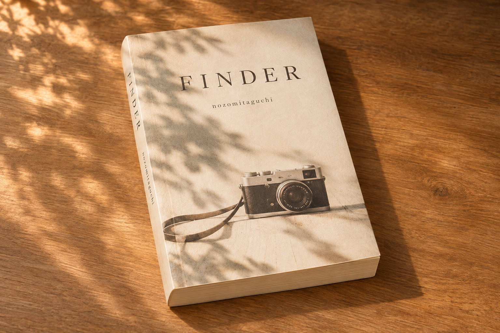
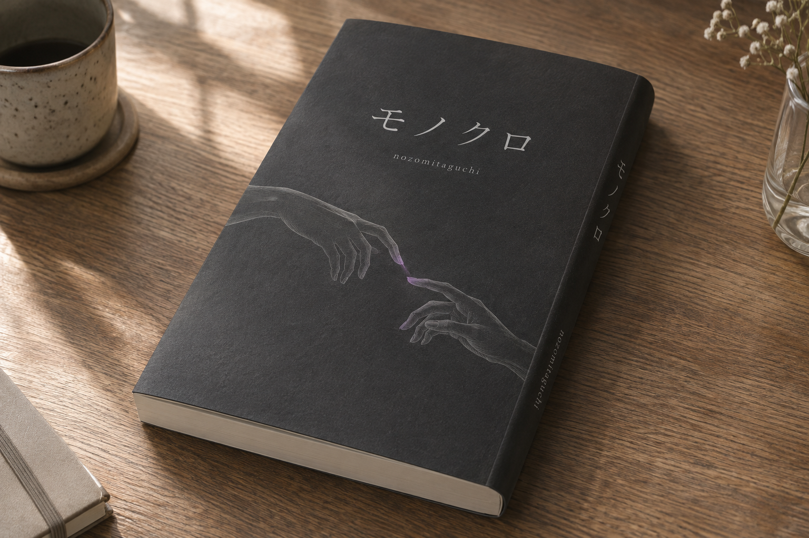

昔作った歌詞や、頭の中にあった物語を、AI とやりとりしながら小説にしています。
プロットを伝えたり、文章を直したり、複数のモデルで読み返したり。そんな試行錯誤でできた作品を、カクヨムにまとめています。

## FINDER

旅人カイが、カメラで幸せを撮る。すると、世界が移る。

[カクヨムで『FINDER』を読む](https://kakuyomu.jp/works/11054822663094452322)

## モノクロ

素手で触れ合うことが禁じられた、灰色の世界。
十歳のテオと少女ヴァイオレットをめぐる、全7話のSF短編です。

[カクヨムで『モノクロ』を読む](https://kakuyomu.jp/works/11054822664712179135)
